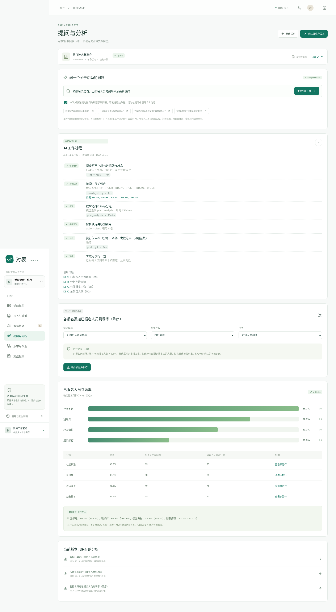
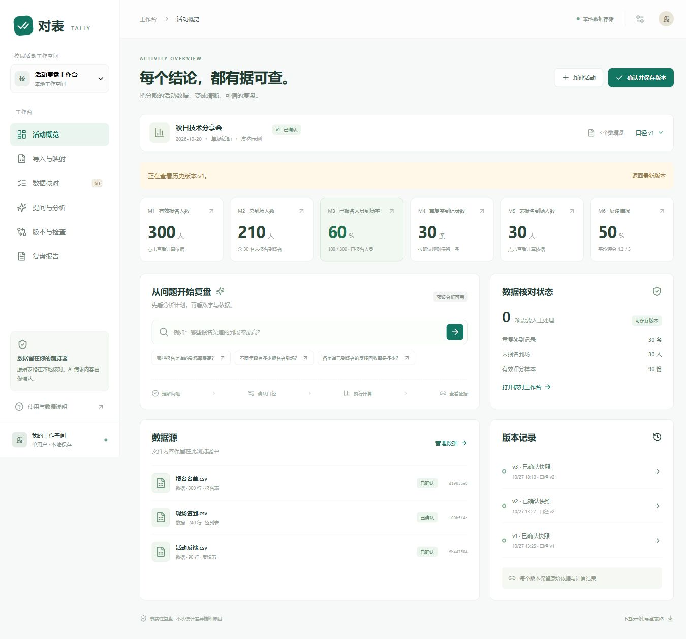

# 对表 Tally

面向校园活动的指标口径核对与可信复盘系统。把报名表、签到表和反馈表核对清楚，用自然语言或推荐问题组织分析，让数字回到原始记录。

系统回答“发生了什么、数字是多少、哪些说法需要重新核对”，不从统计差异推断原因，也不自动给出管理建议。

## 在线演示

**https://webbyoung.github.io/Tally/**

纯静态托管（GitHub Pages），只部署前端构建产物：导入、核对、统计、口径版本、证据溯源、报告导出的完整链路都能用，**数据只留在浏览器本地**，不上传任何服务器。

一处限制（已解决）：静态站点没有 Node 服务端，AI 采用**构建时注入密钥 + 浏览器直连**的方式——`VITE_AI_API_KEY` 在 CI 里从仓库 Secret `AI_API_KEY` 读入，烘进前端包，因此**该密钥对任何访问者可见**。这是公开演示站能开 AI 的唯一形态，代价明确：密钥等同于公开。仓库里不放密钥（走 Secret），泄露路径只有前端包本身；换密钥 = 更新 Secret 后重新发布。

要在自己站点上关闭 AI，删掉 Secret `AI_API_KEY` 重新发布即可，页面自动退回「预设分析可用」。要在本机以「服务端保管密钥」的形态运行，按下方步骤 `npm start`。

## 快速运行

需要 Node.js **22.12+** 和 npm 或 pnpm。无需数据库，不配置 AI 也能使用本地核对、推荐分析、版本和报告。

```bash
git clone https://github.com/WebbYoung/Tally.git
cd Tally
npm install
npm run build
npm start
```

打开 `http://127.0.0.1:8787`，点击 **体验完整示例**。仓库提供 `pnpm-lock.yaml`；使用 pnpm 时执行 `pnpm install --frozen-lockfile` 可复现锁定依赖。

`npm start` 同时提供构建后的页面与 AI 网关，只监听本机。修改代码后重新构建，再刷新页面。

开发时可用 `npm run dev`（5173）与另一个终端的 `npm run server`（8787），Vite 代理 `/api`。开发地址、生产地址、localhost 与 127.0.0.1 的浏览器存储互相独立；换地址前先导出完整备份，再在新地址恢复。

### 可选：真实 AI

复制 `.env.example` 为 `.env`，填写服务商的 `AI_BASE_URL`、`AI_API_KEY`、`AI_MODEL` 后重启 API 服务。Windows PowerShell：

```powershell
Copy-Item .env.example .env
npm run server
```

网关使用兼容 Chat Completions 的 function calling 协议，服务商须支持 `tools` / 指定 `tool_choice`。示例模型名只是配置模板，以账户实际可用模型为准。

**GitHub Token 不能用作模型 API Key。** `.env` 不进入 Git；不要用 `VITE_` 前缀保存密钥。交付时未配置真实模型密钥：参数协议、拒答、恶意参数与映射已使用模拟模型测试，真实模型准确率和兼容性仍须联调。

### Agent 与工具层

分析请求不再是一次「模型直接吐参数」。模型在**只读工具集**上分步行动，工具调用与结果逐条记入轨迹：

| 工具 | 作用 | 是否依赖模型 |
|---|---|---|
| `list_fields` | 列出已确认源表的字段与角色 | 否 |
| `search_policy` | 在本地口径知识库检索条目（TB-ID 防御性插入也能被检索到） | 否 |
| `preflight` | 执行前自检：分母、匿名、发放范围、分组基数 | 否 |
| `compute_metric` | 计算单个指标，返回分子/分母/证据行 | 否 |
| `group_by` | 按渠道/年级分组统计 | 否 |
| `check_claim` | 用固定模板核验一条结论的数字与引用 | 否 |

关键约束：**工具没有一个能写数字**。模型只负责选指标、选分组、写标题；数值全部来自 `engine.ts` 的确定性计算。模型拒答、超时、返回非法参数时，前端降级到推荐问题，不编造结果。



上例是真实模型（deepseek-chat）跑出来的：`list_fields` 2ms 命中 3 张表，`search_policy` 1ms 命中 5 条口径，模型调用 1344ms 返回 `action=plan`，`preflight` 放行。问到现有能力之外的东西（例如「各年级的未报名到场人数」），它会返回 `unsupported` 并说明 M5 是集合差、分组字段只来自报名表——**说得清为什么不做，比硬算出个数更有用**。

反过来说，不该拒的也不能拒。最初版本这里有个真 bug：问「各渠道反馈回收率」时模型答「发放范围未知、无法计算」，而概览页明明显示 50%。原因不是模型笨，是我没把 `policy.invitations` 放进提示词，它只能按知识库的「范围未知则不算」保守拒答。修法是让 `list_fields` 把口径事实（发放范围、去重规则、评分区间、是否有匿名反馈）一并交给模型，并在提示词里明确「已给出具体值的项目不得再说成未知」。修完同一个问题给出 `action=plan`，按渠道算得 100% / 50% / 0% / 0%（65/65、25/50、0/40、0/25）。`tests/agent.test.ts` 有两条测试钉住这件事：提示词必须包含发放范围，且范围为未知时必须如实标未知。

口径知识库（`src/domain/kb.ts`）是本地内置的静态条目 —— 到场率定义、重复记录保留规则、小样本边界、常见错误结论等，带条目编号与版本。检索为词法打分（中文按 2-gram），不联网、不依赖向量库，因此离线可用、结果可复现。回答里的 `KB-M3` 这类编号都能在界面上点开对照原文。


## 已实现

1. **导入与映射**：UTF-8 CSV / XLSX、多工作表选择、文件 SHA-256、重复导入拦截、本地别名建议、可选 AI 表头建议、人工确认。
2. **数据核对**：可靠标识匹配；重复报名/签到/反馈、未报名到场、缺失标识、跨文件重叠和无效评分；处理阻塞项后才能保存。
3. **指标口径**：六张卡片，M6 同时展示回收率与平均评分。到场率直接显示 `180 / 300`。
4. **提问分析（Agent）**：问题 → 六步可追溯流程（查字段 → 检索口径 → 生成计划 → 前置自检 → 定稿 / 修正）→ 可修改参数卡 → 用户确认 → 确定性统计、图表、事实文本和证据侧栏。每一步的状态、耗时、命中的口径条目都在「AI 工作过程」里可见；模型只能填统计参数，数字由程序算。推荐问题走同一套工具层，不伪装成模型输出。
5. **版本检查**：确认快照、历史指标与分析回放、并排对比、修正文件行级差异、数字与引用检查、因果措辞提示。故障注入会真实触发检查失败。
6. **复盘报告**：指标与已保存分析导出 HTML 和证据 JSON；HTML 可用浏览器打印保存为 PDF。附录包括公式、参数、筛选范围、分子分母、原始行号、版本与文件哈希；图表和完整口径一同导出，连续或等间隔行号无损压缩。
7. **工作空间备份**：完整源记录、口径、版本、分析可导出 `.tally.json` 并恢复；导入检查摘要、版本指纹、证据引用。顺序写入 IndexedDB，多标签页冲突停止覆盖，保存状态与离页提醒可见。



## 指标定义

| 卡片 | 定义 | 边界 |
|---|---|---|
| M1 报名人数 | 有效报名标识去重计数 | 缺失标识需处理 |
| M2 总到场人数 | 有效签到标识去重，含未报名到场 | 同一场活动 |
| M3 已报名到场率 | 已报名且到场 / 有效报名 × 100% | 分母为零不计算；分子不等于 M2 |
| M4 重复签到 | 同文件同场次超出保留记录的条数 | 重复文件先拦截；跨文件重叠先核对 |
| M5 未报名到场 | 有效到场集合减有效报名集合 | 不把缺失标识直接归为未报名 |
| M6 回收率 / 均分 | 受邀到场者中有效反馈人数 / 受邀到场人数；有效评分之和 / 数量 | 未知发放范围或匿名反馈不算回收率；缺失和越界评分不计零分 |

重复记录按**原始行序**保留首条或末条，不按签到时间排序。人员标识做 NFKC 规范化、去首尾空白，不去前导零、不按姓名模糊匹配。各表须使用一致脱敏标识。

分组支持报名渠道、年级或总体。分层属性来自报名表，因此仅涵盖可关联报名表的人员，不能外推到全部到场者。满意度针对有效到场反馈，不把缺席者的其他评价当作活动满意度。含匿名反馈时只按记录计算总体评分，不保证一人一份，也不能做人员分层。

## 演示与验证

1. 载入示例：300 报名、240 条签到、210 到场、180 名报名者到场，60% 到场率，30 条重复，90 份反馈，50% 回收率，均分 4.2。
2. 推荐渠道问题 → 确认执行 → 点击 `86.7%` 的条形图，看 `65 / 75` 与原始行。
3. 修改问卷范围为全部到场，保存 v2；回收率从 `90/180=50%` 变为 `90/210≈42.9%`。
4. 对比版本并注入故障，数字与引用检查变红；关闭注入恢复，旧版仍可回放。
5. 导出 HTML 与 JSON，在原文件核对附录。

```bash
npm test
npm run build
npm run preview
```

生产预览默认 `http://127.0.0.1:4173`；需要 AI 时同时运行 API 服务。正式本机运行推荐 `npm start`，无需双终端。`npm run check` 一次完成测试、类型检查、生产构建和 MCP 打包。78 项测试覆盖黄金指标、身份边界、零分母、匿名/无效反馈、跨文件重叠、依赖失效、文字/引用篡改、XLSX、备份与存储冲突、静态服务、模拟模型拒答、Agent 分步轨迹与工具层、口径检索、MCP stdio 端到端。详细脚本见 [演示验收](docs/DEMO.md)，机制见 [架构说明](docs/ARCHITECTURE.md)。

## MCP 服务（给外部 Agent 用）

本项目把自己的确定性计算层做成了 MCP 服务：Claude Desktop、Cursor、IDE agent 等任何 MCP 客户端都能直接调用「算这个活动的到场率」，拿到的数字带分子、分母和原始行号。

**为什么值得做**：通用大模型在 Excel 上算数字会错，而且错得没有痕迹。这里反过来——模型只管说话，数字必须来自工具；工具不联网、不估算、不缓存，同样的输入永远同样的输出。

```bash
npm run mcp:build   # 打包成 mcp/dist/server.mjs（`npm run check` 也会跑）
```

客户端配置（以 Claude Desktop 为例，`claude_desktop_config.json`）：

```json
{
  "mcpServers": {
    "tally": {
      "command": "node",
      "args": ["/绝对路径/Tally/mcp/dist/server.mjs"]
    }
  }
}
```

数据来源是 App 里「工作空间与备份 → 导出备份」的 `.tally.json`，在对话里让 agent 先调 `open_backup`：

```text
打开 /path/to/活动.tally.json，然后告诉我各报名渠道的已报名到场率，并给出每组的分子分母。
```

八个工具：`list_fields`、`search_policy`、`preflight`、`compute_metric`、`group_by`、`check_claim`，加上 MCP 侧的 `open_backup`、`describe_dataset`。全部声明 `readOnlyHint: true`。

服务**不调用任何模型**，也不修改备份文件。它只是把 `engine.ts` 的计算能力搬到了标准协议上——所以 agent 说的每个数都能回到原始行核对。

## 数据与限制

- 数据与版本保存在本浏览器 IndexedDB。清理网站数据、换浏览器或创建新活动前，请通过右上角“工作空间与备份”下载完整备份。备份未加密，含人员标识和原始记录，应妥善保存；报告/证据索引不能替代它。
- AI 提问发送**提问与规范字段名**；AI 映射发送**表头名**，分别确认后发送，不上传原始行。提问、表头中也不要填个人信息。
- 报告不导出人员标识列，但活动名、文件名、分组名和问题标题仍需人工检查。证据侧栏在本地显示原始行。
- 单文件 ≤10 MB、单表 ≤20,000 行、≤100 列、最多 30 个源表；单元格 ≤10,000 字符。完整备份 ≤100 MB、≤100 版本、≤500 分析。这些是保护上限，**不是所有设备和数据形态的性能承诺**。支持 UTF-8 CSV / XLSX；不支持旧 XLS、OCR、手写。
- Excel 公式只读缓存，请先重算。标识应存为文本；数字格式补零或 Excel 数值精度损失不能可靠恢复。
- 首版一场活动、一个本地工作空间；不做协作、单元格内编辑、任意筛选/SQL、趋势预测或管理建议。
- 按指标跟踪源表、映射、相关口径和引用依赖，例如仅改变问卷发放范围只触发回收率重核。相关源文件按整个文件 hash 保守判断，数值未变也可能需要重核。因果关键词可能误报/漏报，需人工审查。
- 网关用于本机开发/演示，无公网认证、租户隔离或限流，不能直接开放公网。
- 已在本机生产页面实测 20,000 报名 + 20,000 签到 + 10,000 反馈的导入、分析、保存刷新、备份与报告导出。该样本 PDF 为 6 页，逐页渲染检查通过。真实数据验收、真实模型联调、极限存储配额仍需外部验证；测试通过不等于获奖保证。

## 代码组织与 Git

```text
src/App.tsx       六个页面和状态编排
src/domain/       engine 确定性统计 / agent 分步循环 / tools 工具契约 / kb 口径库 / gateway 双模式传输
src/components/   AgentTrace 等工作区组件
server/          可选 AI 网关（服务端保管密钥）+ 静态托管
mcp/             MCP 服务：把工具层暴露给任意 MCP 客户端
scripts/         构建与夹具脚本
tests/           指标、文件、溯源、Agent、MCP 测试
fixtures/        虚构原始/清洗/修正 CSV 与期望指标
docs/            架构与演示验收
```

`main` 为可发布分支（受保护，经 PR 合入）；`feat/*` 用于开发。不提交 `.env`、密钥或真实学生表格。

推送 `main` 会触发 [`.github/workflows/deploy-pages.yml`](.github/workflows/deploy-pages.yml)：`npm ci` → `VITE_BASE=/Tally/ VITE_STATIC=1 npm run build` → 上传 `dist/` 到 GitHub Pages。仓库名变化时需要同步改工作流里的 `VITE_BASE`（项目站点路径为 `/<repo>/`）。

静态站的 AI 由仓库 Secret `AI_API_KEY` 注入（构建期变为 `VITE_AI_API_KEY`，浏览器直连模型接口，见上节限制说明）。部署相关环境变量：

| 变量 | 作用 | 默认 |
|---|---|---|
| `VITE_BASE` | 站点子路径 | `/` |
| `VITE_STATIC` | 静态模式：不探测本机网关 | 未设 |
| `VITE_AI_API_KEY` | 有值即启用浏览器直连；为空退回预设分析 | 空 |
| `VITE_AI_BASE_URL` | 兼容 OpenAI 的接口根路径 | `https://api.deepseek.com/v1` |
| `VITE_AI_MODEL` | 模型名 | `deepseek-chat` |

## 可复现规模验收

运行 `npm run fixtures:scale`，在 `.local/scale/` 得到三份虚构 CSV。依次导入确认映射，把问卷范围设为“全部到场者”，保存版本。预期：20,000 报名、10,000 到场、50% 到场率、10,000 重复签到、0 未报名到场、100% 回收、均分 4。十个渠道均为 1,000/2,000=50%。

详细证据见 [验证记录](docs/VALIDATION.md)；[实际打印样本](docs/samples/scale-report.pdf)包含完整口径、图表、文件 hash 和行号附录。
