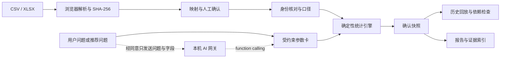

# 架构与可核验边界

React + TypeScript + Vite 前端，PapaParse 解析 CSV，ExcelJS 按需解析 XLSX，Zod 验证有限参数。Node 原生 HTTP 网关只做模型规划，不接收表格、不执行模型代码、不让模型计算指标。

## 记录与版本

- `Source`：源文件 hash、名称、工作表、原始行号、字符串值、映射与确认状态。哈希基于实际文件字节，示例也对应下载 CSV 字节。
- `Snapshot`：UUID、时间、标签、完整项目数据、口径、统计结果、引擎版本与指纹。指纹包括活动元信息，是版本身份，不只是文件摘要。
- `AnalysisRecord`：绑定 snapshotId 的参数和实际结果。重复执行同版本同参数替换该分析记录；源快照不被改写。历史图表回放保存结果，不按最新口径重算。

浏览器 IndexedDB 存单一活动。写入顺序排队，以单一事务比较修订号；其他标签页已写入时拒绝陈旧覆盖。完整备份保留全部输入、版本和分析，恢复前验证格式、SHA-256 摘要、版本指纹、版本关联及行引用。摘要用于损坏检测，不是可信签名。不可变是应用操作约束，不是防篡改审计。用户可自行改浏览器数据库；hash 只能检查字节一致性，不能证明数据真实性。

## 匹配与反馈

人工确认可靠标识后精确匹配；姓名不列为标识候选。重复文件拦截。跨文件同人阻塞保存，需排除具体记录或上传修正版，避免把重复导出误当多次签到。

问卷范围可选全部到场、已报名到场、自定义到场名单、未知。自定义名单去重后取与到场者的交集。回收统计有效身份回答份数；满意度另算有效评分，空值不为零。非匿名且不能关联到场的反馈不纳入到场满意度；匿名记录只提供总体记录均分，不计算回收或分层。

## 受约束的 AI

AI 输出 `plan / missing_data / unsupported / ambiguous`，不能执行时返回原因。服务端校验结构与字段，前端再次验证可计算性、分母和口径。因果和预测问题做规则预拦截。模型仍可能理解错语义，执行前必须由用户检查参数，不能宣传绝对正确。

支持五种统计指标 × 总体/渠道/年级，升降序排序。不支持任意过滤、二维交叉、时间序列、费用收益、缺席者评分或原因分析。

### 分步 Agent 与工具层

`src/domain/agent.ts` 把「一次问答」变成一轮有界的分步循环，上限 6 步、1 次模型调用：

1. `list_fields` — 探查可用字段与就绪状态（纯本地，零成本）
2. `search_policy` — 从 `src/domain/kb.ts` 检索口径条目（词法打分，中文 2-gram，离线可复现）
3. `plan_analysis` — 唯一一次模型调用，返回 `plan / unsupported / ambiguous / missing_data`
4. 组装 — 校验模型引用的口径编号是否真的存在于本轮检索结果里（引用幻觉在这里被拦截）
5. `preflight` — 执行前自检分母、匿名、发放范围、分组基数
6. 定稿 — 输出可执行计划，等待用户确认，**不自动执行**

每一步的 `title / detail / tool / durationMs / status` 进入轨迹，前端 `AgentTrace` 逐条渲染。轨迹是真实的：`list_fields` 的 2ms 和模型调用的 1344ms 都来自实际计时。

工具契约集中在 `src/domain/tools.ts`，六个工具共用一份 JSON Schema，同时供三处使用：模型 function calling、前端 Agent 循环、MCP 服务（`mcp/server.ts`）。**没有任何一个工具能写入数值**——模型只能选指标、选分组、写标题。这条边界让「AI 说错了」变成可定位的问题：要么模型选错参数（可改），要么数字错了（不可能，除非引擎有 bug）。

口径库是有版本的静态条目（`KB-M1`…`KB-M6`、`KB-R1`…`KB-R6`），不是向量库也不是联网检索。优点是可复现、可离线、每条答案都能指回具体条文；代价是覆盖面有限，超出条文范围的问题就应当拒答——这正是 `unsupported` 的用途。

模型侧的事实性约束由 `check_claim` 兜底：它把结论里的数字和引用逐条比对快照，返回 `verified / mismatch / missing`，不判断任意自然语言的真假。

## 真实失败与回放

数字检查仅针对程序固定模板：value 和模板文字都须匹配快照；不声称能够检查任意文字事实。引用核对完整文件、工作表、行号和标识集合，不只看“是否有引用”。因果关键词只能提示审查，存在误报/漏报。

按指标记录依赖：报名人数依赖报名表，到场/重复数依赖签到表，到场率/未报名依赖报名与签到；满意度依赖反馈与签到及量表，回收率依赖反馈、签到与邀请口径，邀请范围为已报名到场时还依赖报名表。相关源文件、映射、口径、数字或证据变化才要求对应旧结论重核；相关文件 hash 仍采用整文件保守检查。“需重核”不意味着旧数值在旧数据中算错。行差异按同类表唯一稳定标识匹配；重复/匿名记录不强行逐条配对。界面可展开旧/新原始行与字段值。

## 导出与运行范围

HTML 报告含指标、限制、源文件、行证据、已保存分析与规则检查；打印 PDF 由浏览器完成，不同打印设置影响分页。JSON 含参数、口径和行索引；自定义受邀 ID 不直接输出，分母行证据可回原表核验。

所有自由文本做 HTML 转义，CSV 下载防公式注入；不保证自动匿名化文件名等自由文本。服务仅监听本机；没有认证、云端数据备份、协作权限或公网部署能力。

已验证：三表共 50,000 行的本机生产界面导入、统计、保存刷新、备份与报告；同一样本 6 页 A4 PDF 无截断或乱码。行号采用连续范围和等间隔序列表示，可完整展开，不做截断。

`npm start` 从 dist 提供生产页面和 API，只允许构建资源路径，阻止私有文件与路径穿越；校验本机 Host 和允许的 Origin。AI 响应限定大小、校验指定工具名称和参数，前端切换上下文时取消旧请求。

待外部验证：真实模型兼容性与语义准确率、真实活动数据适用性、不同设备及极限版本存储配额。
